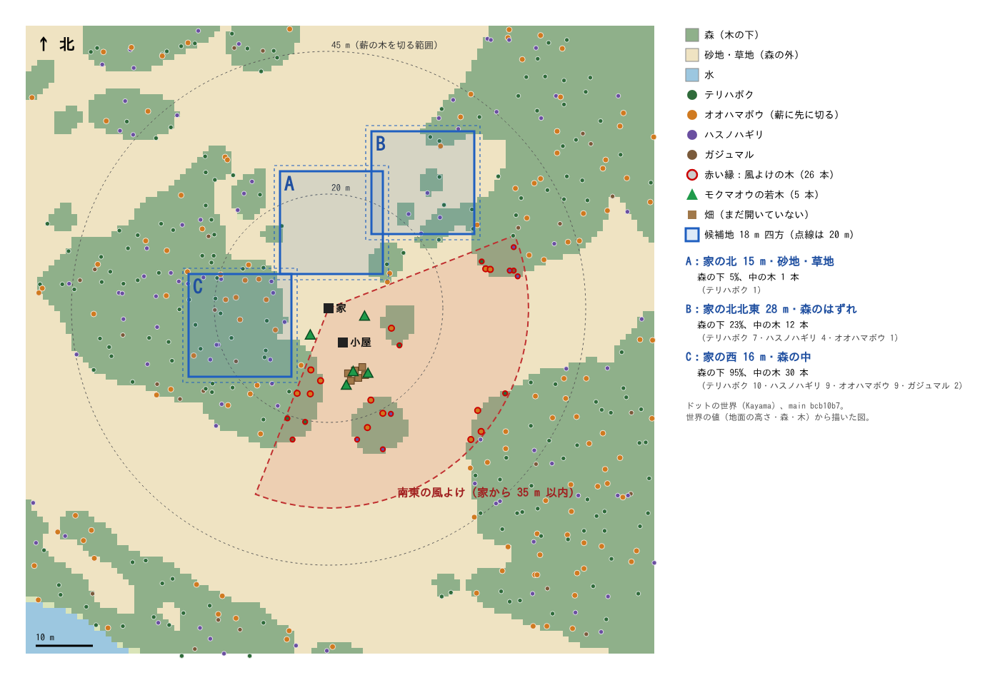

# 炭焼きの林の候補地（2026-10-29、本体）

科学班の D-charcoal-pit §6.3（`science/reviews` の `specs/fire-v0/D-charcoal-pit.md`）にある「候補地は、実装に入るときに本体の撮った画像で科学班が見る」のための図です。植え直し（§6.1・§6.2、オーナー決定 2026-10-25）の PR の前に、林を置く場所を決めます。

## 図の見方
- ドットの世界（Kayama）、main bcb10b7。地面の高さ、森の覆い、立っている木（家から 55 m 以内）を世界の値から描きました。
- 赤い扇形が風よけの範囲です。住人の決まり（`residents.ts` の `windward`）と同じく、**家**を中心に 35 m 以内、南東から左右 66° までを塗っています。家は小屋の北西 6.5 m（61.5, −153）にあります。
  - いまの木の並びで数えると、風よけの木は 26 本です（10/25 の数えでは 22 本）。
- 青い四角が候補地です。実線は 18 m 四方、点線は 20 m 四方です。
- 薪のために切るのはオオハマボウを先にし、テリハボク・ハスノハギリ・ガジュマル・風よけの木は切りません（科学班 10/29）。

## 候補
| | 場所 | 地面 | 森の下 | 中の木（18 m 四方） | 風よけにかかるか |
|---|---|---|---|---|---|
| A | 家の北 15 m | 砂地・草地（森の外） | 5 % | 1 本（テリハボク 1） | かからない（20 m 四方でも） |
| B | 家の北北東 28 m | 森のはずれ | 23 % | 12 本（テリハボク 7・ハスノハギリ 4・オオハマボウ 1） | かからない（20 m 四方でも） |
| C | 家の西 16 m | 森の中 | 95 % | 30 本（テリハボク 10・ハスノハギリ 9・オオハマボウ 9・ガジュマル 2） | 18 m はかからない。20 m だと角が 1 m² かかる |

- **A**：開けていて、切る木がほとんどありません。家にいちばん近く、小屋の北東のモクマオウの若木とも近いです。20 m 四方も取れます。
- **B**：一部が森にかかるので、土地を開く伐採（植え直さない）で 12 本ほど開けることになります。
- **C**：森の中なので、30 本ほどを土地を開く伐採で開けることになります。§6.3 では、そのとき出た木は炭・石灰に使ってよいとされています。まわりの森が風をさえぎります。

本体のおすすめは **A** です。開けた土地なので、林を作るために森を減らさずに済みます。ふいごができて林を広げるときは、A の北と西（森の外の砂地・草地）へ広げられます。

## 決めてほしいこと（科学班）
1. 林の場所：A・B・C のどれにするか。ほかの場所がよければ、それも教えてください。
2. 広さ：まず 18 m 四方（育ち途中が最大 約 32 本、2 m 間隔で足りる）、ふいごのあとに広げる、でよいか。

## 科学班の答え（2026-10-29、#197 のコメント、`specs/fire-v0/D-charcoal-pit.md` §6.4）
- **場所は A**。中のテリハボク 1 本は切らずに残す。家の北にあるので、10〜3 月の北東の季節風もさえぎる。
- **広さ**：まず 18 m 四方。ふいごができたら北と西（森の外の砂地・草地）へ広げる。
- **台風の備え**：家に近い南側の 2 列ほどは、株立ちで低く保つオオハマボウにする。背の高くなる木は北側に置く。倒れた木が家にかからないようにするため。
- **植える木はオーナーの決定待ち**：モクマオウは琉球では人が持ち込んだ木です（環境省の生態系被害防止外来種リストで「重点対策外来種」）。ドットたちの世界は「その島に昔からいる生きものだけ」（オーナー決定 10/26）なので、科学班は林に植える木から外すことを勧めています。
  - 代わりに、オオハマボウを林の中心にし、速く育つ在来の木としてオオバギを候補にする案です。オオバギの薪・炭としての質はまだ確かめていません。
  - 家のそばにいまあるモクマオウ 5 本を残すかどうかも、オーナーが決めます。
