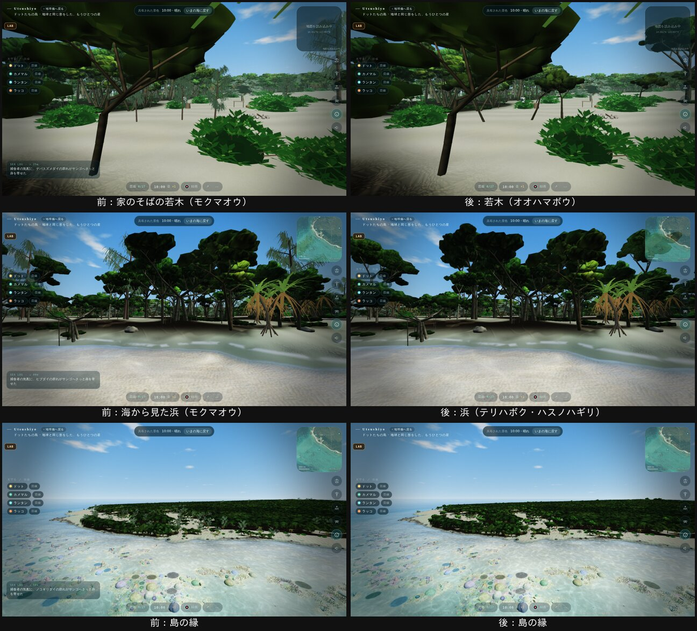

# ドットたちの世界の浜の木を在来の木に（2026-10-31、自然班）

オーナーの決定（10/26「その島に昔からいる生きものだけ」、10/31「すべておすすめで」）により、ドットたちの世界からモクマオウ（琉球では人が持ち込んだ木。環境省の重点対策外来種）をなくします。

## 変えたこと（ドットたちの世界だけ）

| 場所 | 前 | 後 |
|---|---|---|
| 浜の高い木の並び（森の縁、最大340本） | モクマオウ | テリハボク（約7割）とハスノハギリ（約3割） |
| 家のそばの若木5本（ドットが畑のために切る） | モクマオウの若木（2.7 m） | オオハマボウの若木（2.7 m） |

- **自然の世界の嘉弥真**：本物の島と同じで、モクマオウを残します（写真のとおり）。
- **場所・高さ・本数**：今と同じです。どの木になるかは場所から決まり、乱数を引きません。
- **形**：内陸の森と同じ形・同じ描き方（森の `forest.shape()`）を使います。近くは細かい形、110 m より先は粗い形です。
- **幹の太さ**：モクマオウ（0.03×高さ）とほぼ同じです（テリハボク 約 0.03、ハスノハギリ 約 0.023）。そのため、住人が通れない物の登録（solids）は変えていません。
- **図鑑の植物の一覧**（ドットたちの世界）：モクマオウを外し、テリハボク・ハスノハギリ・オオハマボウを足しました。浜の場所の説明は「アダンと木々」にしました。

## 確かめたこと
- **住民の指紋**（`tools/lab/firewood-fixture.ts`）：main と1バイトも同じです（fingerprint.json・fixture.json とも）。
- **確認スクリプト**：`scripts/nav-check.ts` と `scripts/crabs-check.ts` は合格、型チェック・ビルドも通りました。
- **前と後の画**：`tools/lab/native-look.cjs` で撮りました（10:00、晴れ）。

## 別の PR にすること（住民班・科学班）
- 地図の「若木」の下に出る種名（`residents.ts` の `sub: 'モクマオウ'`）と、ルマウ語の単語表（`lexicon.ts`）。
- 若木を切ったあとの木の性質（薪・材としての扱い）。
