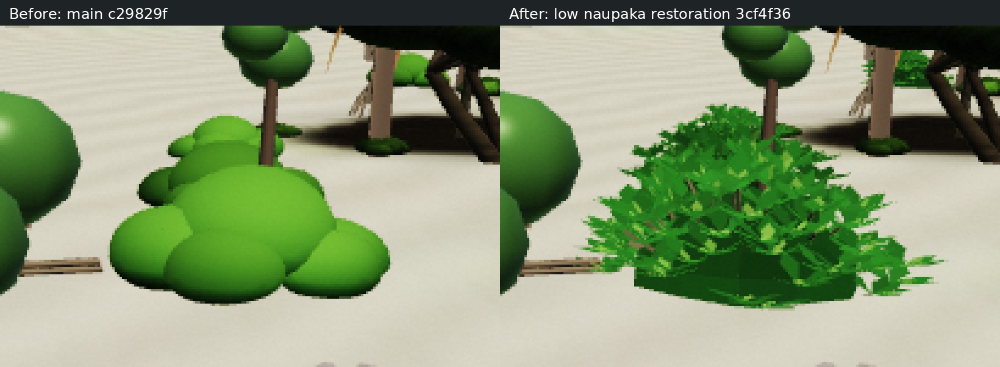

# 低いクサトベラの細枝・葉ロゼット復元（独立試作）

基準: main `c29829f53a2e19852ced6650ecefdff34473edbc`。実装: `3cf4f36`。
若木の [Draft PR #16](https://github.com/ynatsume-source/3dproject/pull/16) とは別ブランチ・別評価。mainへの統合・公開は行わない。

## 変更と根拠

`48febd6d2ad044fc69a3c32ea7b0bba9586410f7` で低いクサトベラが85本のシュート・各8枚の葉から丸い塊に変更された。丸っこい方向の撤回後の `09a99903a1fa9a7053719df1ac93ff81f66eb5f3` にある復元形状を、この1種類だけ戻す。自然ブランチ・ad50d01の取り込みではない。

`src/ocean/naupaka-rosette.ts` はその低木生成手順を使い、現行の種別seed `45` の専用乱数で頂点・法線・色・揺れ・インデックスを作る。同じseedの歴史実装と全配列が完全一致する。過去の共有乱数の位置に応じた全ワールドの形状まで再現するという意味ではない。

元のblob生成とgeometry作成順を維持し、返す直前に低木の属性だけ置き換える。これはThree.jsのUUID用 `Math.random` とicoキャッシュの初期化順を変えず、共有world `R` も消費しないため。余分な丸いモデルを描くわけではなく、mesh/material/geometryの個数は増えない。起動時には破棄する旧属性の生成コストが残る。

既存の共有クサトベラモデルに適用するため、人工fixtureでは島内560株すべてが対象（家の約61,-145から25m以内は18株）。配置・株数・衝突・生活・保存は変更しない。他の5種類の植物/岩/流木の形状ハッシュは完全一致。地表の草シェーダー、モンパノキ、若木、家具は対象外。

## 同条件の実画像と描画値

[全景の左右比較](evidence/comparison.png) / [同じ領域の4倍拡大](evidence/detail-comparison.png) / [変更前原寸](evidence/before.png) / [変更後原寸](evidence/after.png)



左: main c29829f、右: 実装3cf4f36。昼12:00・晴れ・1280×720 high、カメラ (66.8,4.6,-136.5)。同じ人工保存・カメラ・時刻・投影・空・乱数・保存前後ハッシュを比較ツールで照合しPASS。ブラウザ/シェーダーエラー0。HUDの地図読込表示は撮影fixtureに残る。

実画像では、中央の丸い塊が細かな葉先の読める低い茂みに戻った。旧形状を復元した結果であり、全景の自然さの完成評価ではない。基部の暗い面と平たい葉の輪郭は残る。前景の丸い若木・周囲の樹冠は変更しておらず、今回の目標表現として承認する意味でもない。

| 指標 | main | 復元 |
|---|---:|---:|
| scene objects / meshes | 2317 / 2154 | 2317 / 2154 |
| draw calls（全描画pass合計） | 981 | 981 |
| triangles（全描画pass合計） | 12,516,272 | 12,285,552 |
| 同期frame中央値・3試料 | 30,073.5 ms | 30,887.6 ms |
| 相対中央値 | 1.000 | 1.027 |
| 微小移動の明度2階差分 >0.12 の画素率 | 0.4663% | 0.5363% |

三角形は230,720減ったが、共有CPUのSwiftShaderでは中央値が約2.7%増えた。1回・3試料の値で速度向上も実機性能の悪化も断定しない。微小移動診断は輪郭・色・陰影の変化をまとめて含む画像差分であり、実視聴のちらつき改善とは評価しない。初回は昼の近景のみ。追加の夕・夜・390×844 mediumと短いカメラ移動の結果は[追加比較資料](extra/README.md)を参照。実機の連続視聴は未実施。

## 検証

- 歴史実装とのgeometry全配列一致、有限値、geometryオブジェクトの再利用、両共有乱数を禁止した呼び出し: PASS。
- 別プロセスでの生成監査: Math.random 555,058回、world R 0回、各次の8値が一致。他5種類の形状と境界も一致。
- 同一人工fixture: 海岸植物の全配置・家周辺100mの森林/solids、60秒の生活、保存、森林伐採、若木伐採・切り株遷移までの指紋が一致。
- 既存wall検査はbefore/afterともPASS。既存nav検査PASS。検査の条件や閾値は変更していない。
- `npm run typecheck` / `npm run build`: PASS。
- slow検査・実GPU・長時間配信は未検証。初回HEADのfast CIは成功。追加検証を保存した最終HEADのCI結果はPR本文で記録する。

証跡は [evidence](evidence/) 内。人工保存のみを使用し、利用者の保存や実APIは使用していない。

## 再現

依存導入済みの両worktreeで以下を実行。前後を別プロセスで測り、icoキャッシュの状態を混ぜない。

```sh
npx tsx --import ./scripts/node-assets.mjs tools/lab/naupaka-geometry.test.ts
npx tsx --import ./scripts/node-assets.mjs tools/lab/naupaka-audit.ts /tmp/audit.json
npx tsx --import ./scripts/node-assets.mjs tools/lab/naupaka-fixture.ts /tmp/naupaka-state
npx tsx --import ./scripts/node-assets.mjs scripts/wall-check.ts
npx tsx --import ./scripts/node-assets.mjs scripts/nav-check.ts
npx vite build --minify false
npx vite preview --host 127.0.0.1 --port 5326 --strictPort
```

main側にも同一のcapture/fixture/auditハーネスをコピーする。通常のframeループを停止するため、撮影のみ非圧縮buildを使用する。外部通信はブロックし、同じfixtureファイルを前後に渡す。

```sh
PLAYWRIGHT_MODULE=/opt/codex/cua_node/lib/node_modules/playwright/index.mjs \
CHROME=/usr/bin/chromium URL=http://127.0.0.1:5326 \
FIXTURE=/workspace/naupaka-evidence/before-state/fixture.json \
CASE=desktop-home-near-day FLICKER=1 OUT=/tmp/naupaka-after \
node tools/lab/naupaka-capture.mjs
node tools/lab/naupaka-compare.mjs /tmp/naupaka-before/report.json /tmp/naupaka-after/report.json
```

## 限界

復元の葉は平面のロゼットで、細枝の一部だけをgeometry化する元の表現。高精細な植物モデルへの刷新ではない。現行の揺れシェーダーは変更していない。葉先の見かけの範囲は丸い塊より広いが、既存の植生通行判定/衝突の代理寸法は保つ。見た目と代理寸法の差は残る。

1モデルの三角形は2,240→1,828、頂点は1,134→3,656。三角形減だけで描画が速いとは判断しない。SwiftShaderの同期frame時間は共有CPU上の参考値であり実機FPSではない。4frameの微小移動による明度2階差分は診断値であり、実際のちらつきの合否や自然さを証明する測定ではない。
