# 比較結果

昼は両サイズともPNG画素が完全一致。新月は地面・棚・樹木間の空間が読めるようになった。青みは増すが、焚き火の暖色と夜の暗さは残る。満月の追加分は控えめ、曇天は晴天新月より暗い。採用確定ではなく、見た目をレビューするdraft。

## 固定条件・状態

8条件すべてで、カメラ位置・回転・射影・時刻・uniform・保存開始/終了SHA・乱数消費/指紋・objects/meshes・draw calls/trianglesがA/B一致。全条件2,317 objects／2,154 meshes。薪24kg・可視丸太8本・伐採1本を維持。60秒のヘッドレス生活トレース・乱数・保存・fixtureの指紋も完全一致。

## フレーム時間

SwiftShaderの全フレーム＋同期readback、2暖機・3標本の中央値。実機性能ではない。

| 条件 | before ms | after ms | after/before | calls 前後同数 | triangles 前後同数 |
|---|---:|---:|---:|---:|---:|
| desktop-day | 20129.7 | 20167.8 | 1.0019 | 976 | 12,471,592 |
| desktop-new-moon | 21315.2 | 20871.9 | 0.9792 | 983 | 12,471,667 |
| desktop-full-moon | 26646.5 | 21545.5 | 0.8086 | 983 | 12,471,667 |
| desktop-cloudy-night | 20693.8 | 20167.2 | 0.9746 | 983 | 12,471,667 |
| phone-day | 10907.4 | 9691.2 | 0.8885 | 944 | 11,858,416 |
| phone-new-moon | 9516.2 | 10141.1 | 1.0657 | 946 | 11,858,456 |
| phone-full-moon | 10352.7 | 9786.5 | 0.9453 | 946 | 11,858,456 |
| phone-cloudy-night | 9895.1 | 9533.3 | 0.9634 | 946 | 11,858,456 |

phone新月は+6.57%。昼が画素一致でもphoneは−11.15%、desktop満月は−19.14%と幅がある。高速化とは主張しない。少数標本・ソフトウェア描画のため実機での回帰は否定できない。旧試作の4.7%を許容閾値として使わない。

## 検査

- typecheck・本番build: 成功
- check:fast: 42/42 成功
- 状態読み取り: 5/5 成功
- shader-check: planet/kayama/gbr × low/high、6/6 成功
- 実機GPU、Windows ANGLE/D3D11、24時間連続運転: 未検証

## 比較画像

元PNG。左before、右after。外部通信を遮断したため地図は読み込み表示。native timer由来の操作ヒント表示には差があり、世界状態の差ではない。

### desktop-day

| before | after |
|---|---|
|  | 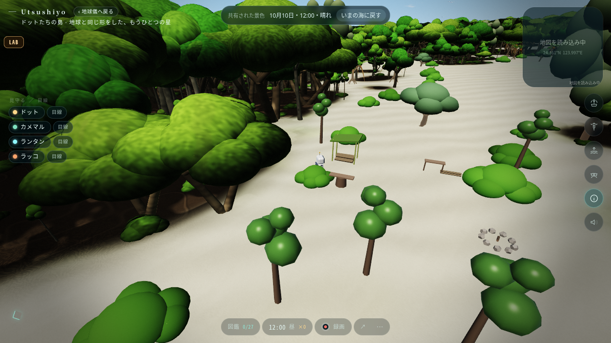 |

### desktop-new-moon

| before | after |
|---|---|
| 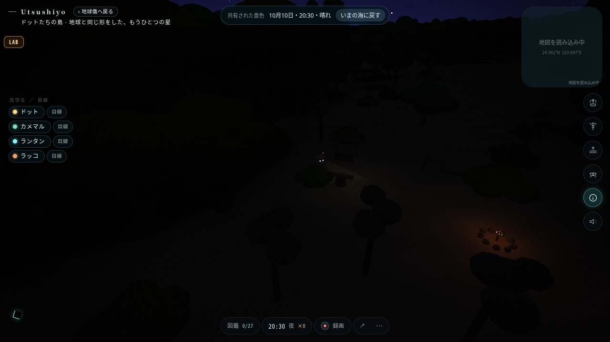 | 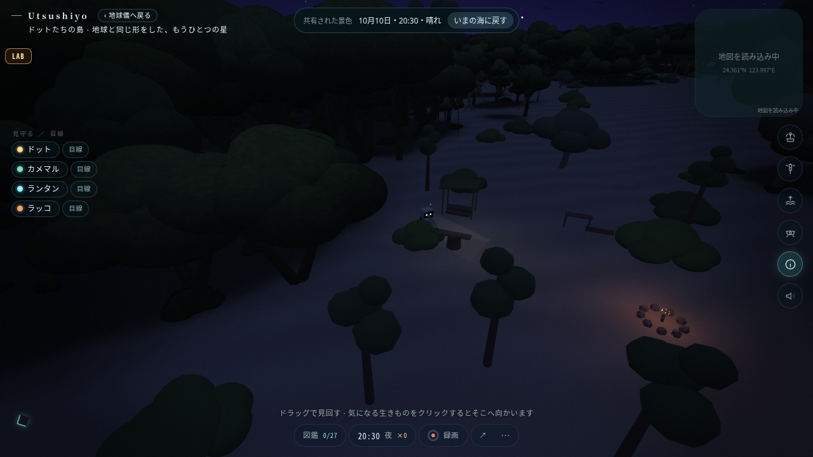 |

### desktop-full-moon

| before | after |
|---|---|
| 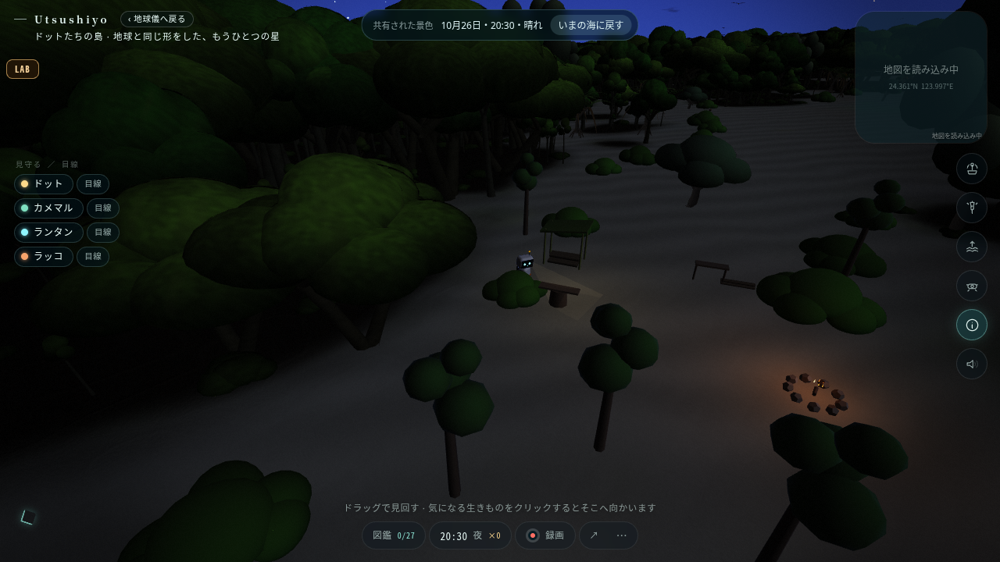 | 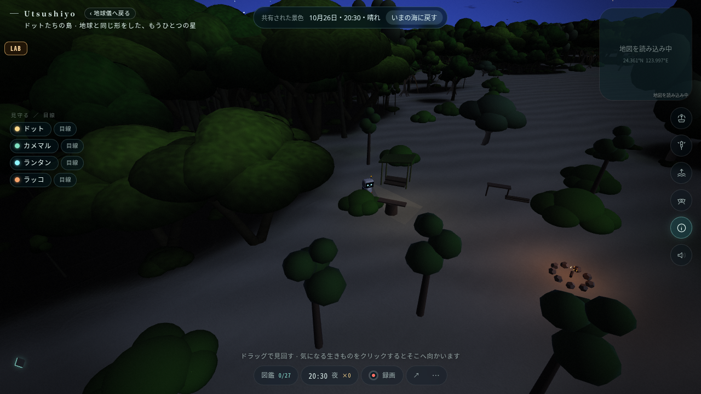 |

### desktop-cloudy-night

| before | after |
|---|---|
| 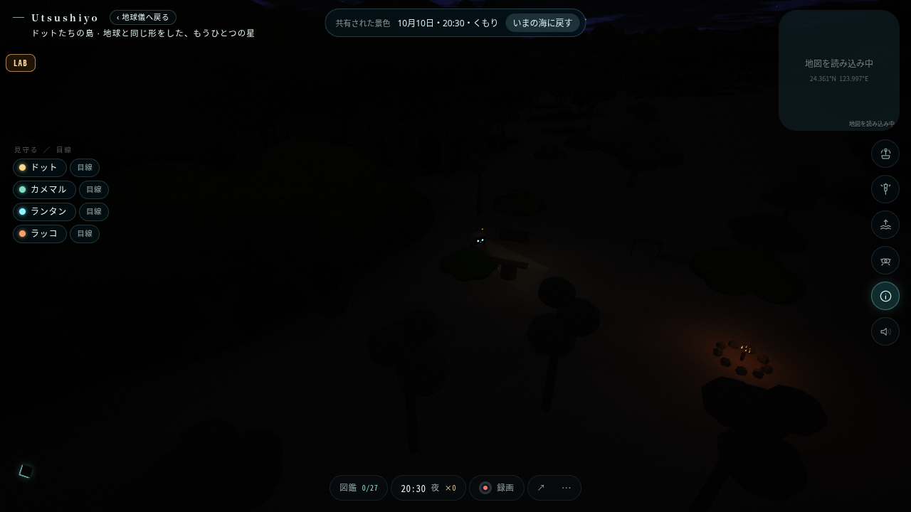 | 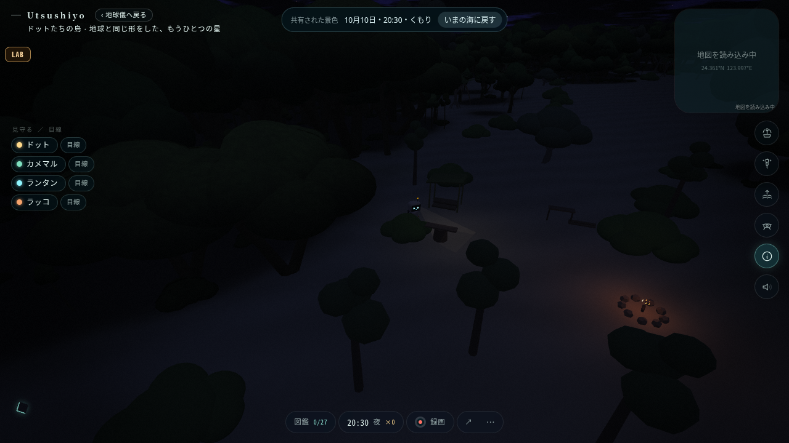 |

### phone-day

| before | after |
|---|---|
| 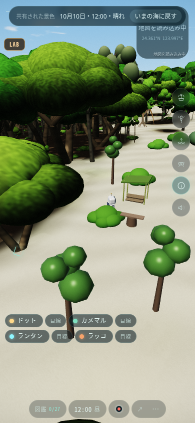 |  |

### phone-new-moon

| before | after |
|---|---|
| 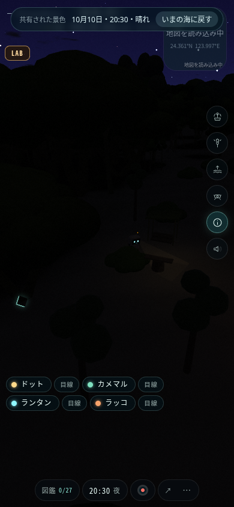 | 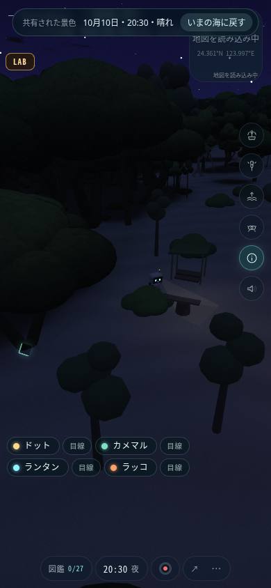 |

### phone-full-moon

| before | after |
|---|---|
| 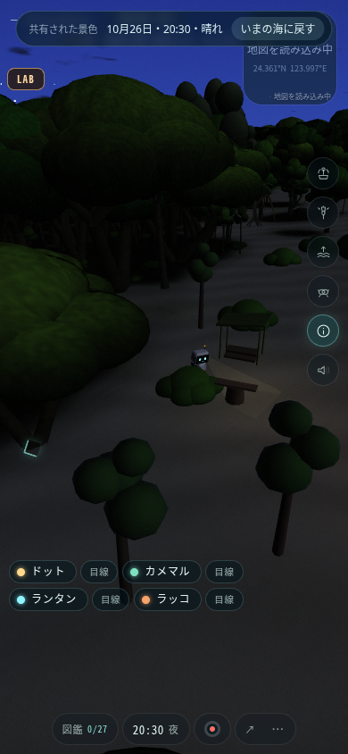 | 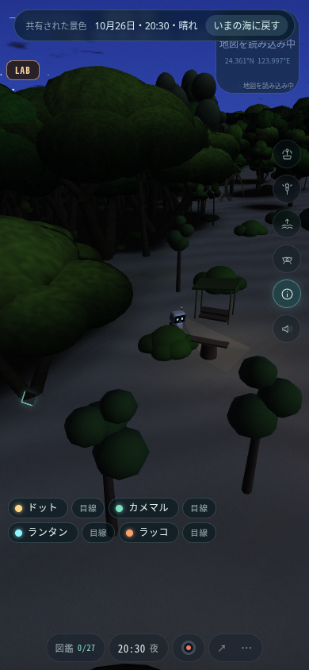 |

### phone-cloudy-night

| before | after |
|---|---|
| 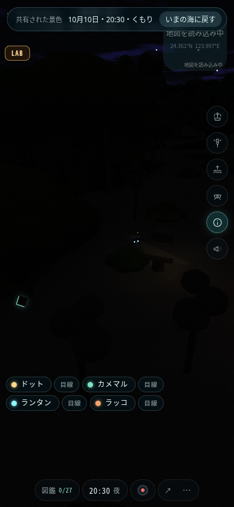 | 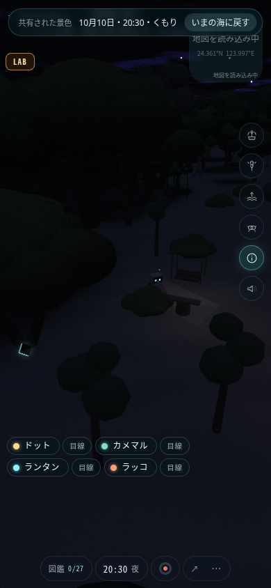 |

## 限界と次の判断

共有airLitの補助光なので森林内部等にも加算され、遮蔽物を考慮した物理照明ではない。薪の断面・本数の読みやすさ自体は造形未変更のため未解決。夕方・全地点・全状態は撮影していない。自然ブランチ、夕日、月表示の別変更は取り込んでいない。科学係数・AIの視認範囲は変更なし。

Libraryへの比較画像16枚の正式保存はネットワーク障害で失敗し、保存IDなし。画像はこのPRのevidenceに保全。参考画像5枚の取得も未完了で、画像依存の薪造形試作は保留。

## 新規A/A（変更版を反復）

同一shader・保存・カメラ・時刻・seed・2暖機/3標本の新月を反復。状態・描画量・乱数の厳密比較は両サイズとも合格。

| 条件 | 初回ms | 反復ms | 反復/初回 | PNG画素一致 |
|---|---:|---:|---:|---|
| desktop-new-moon | 20871.9 | 23400.0 | 1.1211 | False |
| phone-new-moon | 10141.1 | 13366.2 | 1.3180 | True |

A/Aでもdesktop +12.11%、phone +31.80%の時間差が生じた。この環境の比較は性能採否に不十分であり、許容閾値を設定しない。実機での性能回帰の有無は未判定。描画負荷の構造的指標（モデル・draw calls・triangles）が増えていないことだけを確定結果とする。

A/Aのdesktop画素差は操作ヒントの矩形 `(437,641)–(842,662)` のみ（0始まり、右下排他）。その領域外の世界描画は画素一致。phoneは画面全体が一致。UIのnative timerは撮影時間固定の対象外。
