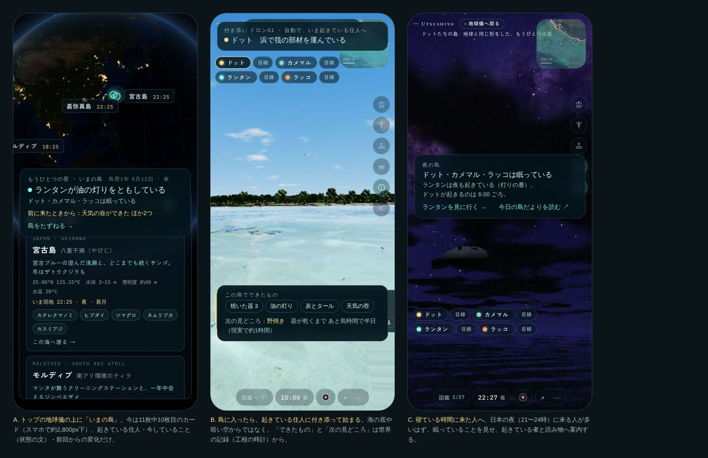
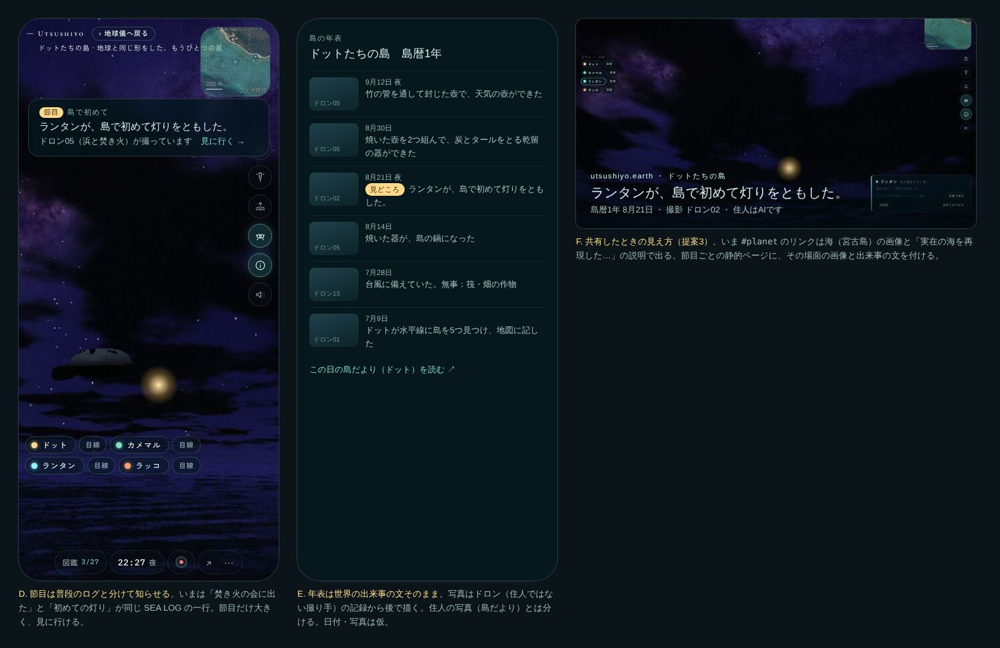

# 見る人の側から：現状診断と3つの提案（2026-10-11）

> **2026-10-16 追記**：住人の島はライブ配信中心にする方向になった。最新は `../viewer-design-2026-10-16/README.md`。この文書の 1-a は取り下げ、ほかの扱いは同文書の §12 を参照。

視聴者と発信の設計担当より。**未採択の提案**で、正式な仕様ではありません（docs/proposals/README.md）。
実装はしていません。住人の言葉・判断・科学の中身には触れていません。物の見た目は「自然班への依頼」として分けています。
方針と優先順位はオーナーが決めます。提案ごとに選べる形にして、根拠と手間を付けました。

- 図：`now-*.jpg`（いまのアプリ）、`mock-1-first-minute.jpg`・`mock-2-milestones.jpg`（提案のモック。元は `mock.html`）
- まとめ：**提案1（入口と最初の1分）→ 提案2（見どころを知らせて残す）→ 提案3（持ち帰ってもらう）** の順をすすめます。1 がないと 2・3 で人を呼んでも、来た人が空っぽの島を見ることになるためです。

---

## 0. どう調べたか（と、確かめていないこと）

| | 内容 |
|---|---|
| 読んだもの | README・CLAUDE.md・docs/ARCHITECTURE.md・DOTWORLD_ROADMAP.md・ADR 0007・JOURNAL.md、proposals のうち outreach.md・codex-followups-2026-10-10・nature-look-2026-10-09。コードは見せ方に関わる所だけ（`src/ui/share.ts`・`hints.ts`、`main.ts` の島カード・見守り・SEA LOG・計測、`residents.ts` の出来事の文、`scripts/journal-pages.ts`・`og-pages.ts`、`index.html` の OG） |
| 見たもの | 本番の https://utsushiyo.earth/ と `#planet`、`/journal/`（2026-10-11 22:25〜22:40 JST）。Playwright + Chromium（SwiftShader のソフトウェア描画）で、スマホ縦 390×844（タッチ）と PC 1440×900。夜はそのまま、昼は共有リンクの `?time=10:00#planet` で開いた |
| 確かめていない | **実機（iPhone / Android / Windows の GPU）では見ていない**。ソフトウェア描画は1コマが重く、海の時間そのものが遅くなる（ARCHITECTURE §7：50 ms 超で遅くなる）ため、住人の進み方・カメラの追いつき方は実機と違う可能性が高い。音も聞いていない。どれも新しいブラウザ（保存なし）で開いたときの見え方 |

---

## 1. 現状診断

### 良いところ（そのまま守りたいもの）

1. **世界が本物でできている**。空・星・潮・天気（地球の海は今の実測、島は過去の観測記録の再生）、住人の状態の文は実際の状態から、日記の数値は本当に測ったものだけ。「作られた感動」がない。これは発信でいちばん強い武器で、ほかの AI の村や箱庭との違いになる。
2. **島だよりの作り**：住人が自分の記録と自分の写真だけで書き、運営者の承認（PR のマージ）を通してから出る。「住人はAI」の明記、記事ごとの OG 画像、Atom フィード、外部リンク禁止まで揃っている（`scripts/journal-pages.ts`）。
3. **見守りの入口がすでにある**：4人のボタン、状態の文（「海の見える場所へ向かっている（あと67m）」）、目線、日記帳。ドロンの番号の設定（ADR 0007）は、撮り手の存在を見る人に説明できる良い設定。
4. **静かさ**：控えめな案内（`hints.ts`、1つずつ数秒だけ）、録画は押すまで何もしない。流しっぱなしの観賞に合っている。
5. **共有リンクがその瞬間を運ぶ**：時刻・天気・ガイドを URL に入れ、開いた側に「共有された景色」と出る。

### もったいないところ

| # | 見えたこと | 根拠 | 見る人にとって |
|---|---|---|---|
| M1 | **初めて来た人は、何もできていない島を見る** | 住人の保存はブラウザごと（`seaglass.residents.v1`）。新しいブラウザで見守ると「小屋の部材 0/24」「目印の石積み 0」、日記帳は「まだ何も書いていないようです」（now-5、pc-night 日記）。器・灯り・炭とタール・天気の壺まで進んだ島は、島だよりの毎日の実行（`journal-data`）か、ずっと開いていた人のブラウザにしかない | 「灯りがともった」と聞いて来た人が、灯りのない島を見る。発信と体験がつながらない |
| M2 | **島が見つからない** | トップは「潜る海を選ぶ」。島のカードは11枚中10枚目で、スマホでは約2,800px下（now-2）。`index.html` の説明・OG は海の話だけ | 住人がいることを知らずに帰る人が多いはず |
| M3 | **入ってから住人に会えない** | 昼（10:00）は海の底の砂地から始まり、65秒たっても住人は映らない（now-4・now-6）。夜（22時台）は暗い空と雲、浮かぶカメマルの影だけ（now-3）。ランタンを押しても30秒後の画面は星空だけ（now-7、描画が遅いせいもありうる） | 「誰が・どこで・何をしているか」が最初の1分で分からない |
| M4 | **日本の夜に来ると、ほとんど寝ている** | 22時台はドット・カメマル・ラッコが眠る時間。ランタンは昼に眠る（10:00 で「眠っている」）。夜に「眠っている」ことは説明されない | 見る人が来やすい時間（仕事のあと）に、何も起きていないように見える |
| M5 | **節目がふつうの一行に埋もれる** | 住人の出来事は `onEvent(kind, text)` で SEA LOG に出るが、種類（`kind`）は捨てられ（`main.ts` 2230行）、「焚き火の会に出た」と「島で初めて灯りをともした」が同じ重さ。器が割れたこと・作り直したことには専用の文がない（工程の結果の文になる） | 一番の見どころを、居合わせても見逃す。あとからも探せない |
| M6 | **発信がまだ外に出ていない** | `/journal/` は記事0本（「まだ記事はありません」）。アプリから島だよりへの道はメニュー（⋯）の中だけ | 持ち帰るもの・人に見せるものがない |
| M7 | **島の共有リンクが海の顔をしている** | `#planet` の共有はトップの OG（宮古島の画像、「実在の海を再現した…」）で出る。地球の海には `og-pages.ts` で海ごとのページがあるが、島にはない | SNS に貼っても住人の話だと伝わらない |
| M8 | **良くなったかを測れない** | 計測（GA4）の `sea` は `loc.id` で、地球の嘉弥真島と住人の島がどちらも `kayama`。見守り・日記帳・島だより・節目のイベントはない。島だよりと OG ページには計測がない | 何を変えても効果が分からない |
| M9 | 小さな見た目の問題 | スマホのトップで、地球儀のピン「グレートバリアリーフ」がパネルの見出し「UTSUSHIYO ウツシヨ」に重なる（now-1）。島に入って20秒ほど右上の地図が「地図を読み込み中」のまま。見守りボタンが8つ（名前4＋目線4）で、スマホでは画面中央を2段ふさぐ | 細かいが、最初の印象を下げる |

**一言でいうと**：作り込まれた世界と、毎日進む物語の両方があるのに、**見る人が来た瞬間に見るのは「物語の第0話」**で、しかも主役がどこにいるか分からない。発信を増やす前に、ここをつなぐのが一番効く。

---

## 2. 見る人に出してよい情報の区分（オーナー判断用の案）

住人に見えないものを見る人に見せるかどうか。住人の言葉・判断には混ぜず、**画面上でも書き手を分ける**（住人の言葉＝吹き出し・日記、世界の記録＝年表・状態、観測者の注記＝ドロンのラベル）ことを前提にした案です。

| 区分 | 例 | 案 | 理由 |
|---|---|---|---|
| **A. 出してよい**（住人も知っている／世界の事実で、住人の判断を変えない） | 住人の状態の文、日記、焚き火の会の発言、できた物とその数、島の時刻・島暦の日付、出来事の文 | そのまま出す | すでに出している。文言は世界が作ったものをそのまま使う |
| **B. 観測者の注記として出してよい**（世界は知っているが住人は知らない。書き手を「ドロン／記録」と明記） | 工程の残り時間（「器が乾くまで島時間で半日、現実で約1時間」）、待ちの工程の名前、天気の記録の値（気温・気圧・風速、どの年の石垣島の観測か）、地球の地名（嘉弥真島） | 出してよい。ただし住人の吹き出し・日記の中には入れない。単位つき・出典つき | 戻ってくる理由（予告）になる。地名は ADR 0006 で「視聴者向けの画面にだけ添える」と決まっている |
| **C. 決めてほしい**（物語の緊張を左右する） | **台風が来ることの予告**（記録の再生なので世界は先を知っている）、天気の壺の読みが「当たったか」の答え合わせ | 選択肢：①出さない（住人と同じ立場で待つ）②来る前に「記録では○日後に台風」と見る人にだけ出す（ハラハラは増えるが、壺が「予報」する驚きは減る）③過ぎたあとの年表でだけ答え合わせ。**おすすめは③**、慣れたら②を試す | 「天気の壺が台風の前に動く」を見どころにするなら、見る人が先に答えを知らない方が驚ける |
| **D. 出さない（おすすめ）** | 報酬・期待値・信頼の数値、AI への入力と生の返答、AI の費用、乱数 | 出さない（研究ページを作るなら別扱い） | 「人間臭さを演出しない」住人を、数値の操り人形に見せてしまう。費用は運営の話 |

---

## 3. 提案

### 提案1　入口と最初の1分：「公式の島」から始めて、起きている住人に会わせる【優先度：高】

**何を**

| | 内容 | 手間 | 担当 |
|---|---|---|---|
| 1-a | **公式の島から始める**。毎日の島だよりの実行が続けている島（`journal-data` の `storage.json`）を、実行のたびに読み取り専用の写し（例：`/island/state.json`）として公開し、**保存のないブラウザはそれを住人の初期値にする**。以後はそのブラウザで続く（いまの追いつき方式のまま）。APIキーなど本人の設定は含めない | 中〜大 | 本体（保存の互換・サイズ・時計の扱い） |
| 1-a′ | （軽い代案）シミュレーションは各ブラウザのまま、公式の島の**記録だけ**（できた物・年表・今日の島だより）を静的 JSON で出し、トップと島の中に「公式の島では」と書いて見せる | 小〜中 | 本体 または Codex |
| 1-b | **トップに「いまの島」**。地球儀の上（スマホではパネルの先頭）に一枚：島の時刻、起きている住人と状態の文、前回来たときからの変化（1-a か 1-a′ の記録から）。島のカードは「もうひとつの星」として先頭に近い位置へ。`index.html` の説明・OG にも住人の島を一文入れる | 小 | Codex（文言はオーナー確認） |
| 1-c | **入ったら起きている住人に付き添って始まる**。`#planet` とトップの帯から入ったときは、起きていて動いている住人を選んでその付き添いドロンで始める（昼はドット、夜はランタンが多いはず）。全員寝ていたら、寝姿と「次に起きるのは○時ごろ」（区分B）、それと今日の島だより・年表へ | 小〜中 | 本体（監督・見守りの既存の仕組み） |
| 1-d | 見守りボタンを1段に：名前4つだけにし、「目線」は見守り中のカードの中へ（いまもカードに「目線で見る」がある）。起きている人に小さな印 | 小 | Codex（`overlap.cjs` を通す） |
| 1-e | M9 の小さな問題（ピンとパネルの重なり、地図の読み込み表示） | 小 | Codex |

**なぜ**：M1〜M4。どんな発信で人を呼んでも、最初の1分で「誰が・何をしていて・ここまで何ができたか」が分からなければ戻ってこない。1-a は発信（島だより・年表・SNS）で語る島と、来た人が見る島を同じにする唯一の方法で、ADR 0002 の「全員で同じ島の歴史を見る」への一歩にもなる（サーバーなしで、毎日1回の写しで）。

**見る人にとって**：開いて数秒で、住人の誰かが画面にいて、何をしているかが一行で分かる。「器が3つ、灯り、天気の壺までできた島」だと分かる。夜に来ても、眠っている理由と、起きている者・読み物がある。

**気をつけること・本体に確かめたいこと**
- 1-a の時計：通常モードの住人はまだ観賞の時計（`clock.ms`）で動く（既知の課題）。公式の島を初期値にすると、見る人の早回しで「公式」と食い違っていく。1-a を入れるなら、観賞の早回しで住人の履歴が変わらない（ADR 0001）ことの実装が前提か同時になる。
- 公式の島は毎日 6:00〜20:00 だけ生きる（`journal-run.ts`）。夜の灯りや焚き火の会が公式の記録に入るかを確認したい。
- 写しにはプライバシーに関わるものはないはずだが（`seaglass.aikey` は入らない、JOURNAL_LOCAL.md）、公開前に中身の一覧を確認する。
- 見え方：新しい描画は増やさない。1-b〜1-d は HUD とカメラの選び方だけ。

### 提案2　見どころ（節目）を知らせて、残す【優先度：中〜高】

**何を**

| | 内容 | 手間 | 担当 |
|---|---|---|---|
| 2-a | **出来事に格を付ける**：いま捨てている `kind` を画面側に渡し、「節目」（島で初めての○○、物ができた、筏ができた・渡航、台風が来た／過ぎた・備えの結果、器が割れた・作り直した）と「ふだん」に分ける。文言は世界の文をそのまま使う。割れた・作り直しは工程の結果（失敗・破片に戻る）から節目にする | 小 | 本体（文の追加が要るなら本体が判断。住人の言葉は変えない） |
| 2-b | **居合わせたら知らせる**：節目は SEA LOG の一行でなく、上に数秒の札（「節目　島で初めて」＋文＋「見に行く」）。見に行くと近くの定点ドロン（05 浜と焚き火 など）か付き添いドロンの視点へ | 小 | Codex |
| 2-c | **来なかった間の節目を伝える**：前回の訪問からの節目を、入ったときに一度だけ「前に来たときから：天気の壺ができた ほか2つ」 | 小 | Codex（1-a か 1-a′ が前提） |
| 2-d | **島の年表**：節目だけを島暦で並べた一覧（アプリ内のパネルと、静的ページ `/island/`）。各行から、その日の島だより・写真へ | 中 | 本体（データ）＋ Codex（ページ。`journal-pages.ts` と同じ作り） |
| 2-e | **ドロンの記録写真**：節目の瞬間に、近くのドロンの位置・向き・時刻を世界の記録に残し、毎日の実行で写真を描く（`tools/journal/photos.cjs` と `?journalshot` と同じ仕組み）。**撮り手はドロンで、住人の写真（`PhotoRecord`、1日3枚）とは別に数え、別に表示**。ドロンは世界に触れない（ADR 0007）ので、住人の記録・判断には入れない | 中 | 本体 |
| 2-f | **次の見どころの予告**：進行中の待ちの工程（乾燥・野焼き・浸漬など）の残り時間を、島時間と現実時間で（区分B）。例「野焼き：器が乾くまで島時間で半日（現実で約1時間）」 | 小〜中 | 本体（`process-runner` の時計から） |

**なぜ**：M5。この島の見どころは「待って、試して、うまくいったり壊れたりする」こと。節目が一行に埋もれ、あとから探せないと、物語が見る人に届かない。2-f は「また来る理由」そのもの。録画を勝手に始めない（オーナー判断）ので、残す手段は 2-e の後から描く写真にする。

**見る人にとって**：居合わせれば「いま、初めて灯りがともった」と分かって見に行ける。居合わせなくても、次に来たときと年表で分かる。「あと1時間で野焼き」が分かると、その時間に戻ってくる。

**台風と天気の壺**：天気の壺が台風の前に動く場面は、区分Cの判断しだい。おすすめ（③）なら、台風が過ぎたあとの年表に「天気の壺が○日前から動いていた／台風が来た」を並べる（どちらも世界の記録）。見る人は答え合わせを年表で楽しむ。

### 提案3　持ち帰ってもらう：島だより・ダイジェスト・切り抜き・共有リンク【優先度：中】

**何を**

| | 内容 | 手間 | 担当 |
|---|---|---|---|
| 3-a | **島だよりを外に出す**：本番の記事は0本。原因（Secrets・PR 権限・写真の描画・マージ待ちのどれか）を確かめて、まず1週間続けて出す。アプリの見守りカード・夜の案内（1-c）・年表から「今日の島だより」へ直接 | 小（運用） | オーナー＋本体 |
| 3-b | **島の共有リンクを島の顔に**：`/island/`（2-d）を OG 付きの静的ページにし、`#planet` の共有はそこを経由。画像は最新の節目のドロン写真（2-e）、題は節目の文、「住人はAI」を説明に。節目ごとに `/island/<日付>-<節目>/` も作れるとSNSで強い | 小〜中 | Codex（`og-pages.ts` の延長） |
| 3-c | **SNS 向けの切り抜き**：節目1つにつき「ドロン写真1枚＋節目の文＋島暦の日付＋住人はAI」の画像（1200×630 と 1080×1350 の縦）。島だよりと同じく**下書き → PR → マージで公開**。配信先はオーナーが決める（未決） | 小（2-e のあと） | Codex |
| 3-d | **週のダイジェスト動画**（60〜90秒、横16:9 と縦9:16）：その週の節目のドロン写真と島だよりの写真を、ゆっくり寄る静止画で並べ、字幕は節目の文と住人の日記からの引用だけ。音はアプリの生成音楽を録ったもの（ピアノ音源は CC BY のクレジットを付ける）。ソフトウェア描画で動画を撮るのは遅いので、**静止画をつなぐ方式**からはじめる | 中〜大 | 本体（Actions の仕組み）＋ Codex（組み立て） |

**共通の決まり（案）**：世界の文と住人の言葉は変えない・足さない。数字は世界が測ったものだけ。すべてに「住人はAI」「運営者が確認して公開」。外部リンク・宛先（@）なしは島だよりと同じ。

**なぜ**：M6・M7。いま外に持ち出せるものがない。3-a は手間が小さく効果が大きい。3-b〜3-d は 2-e のドロン写真があればほぼ同じ材料で作れる。

**見る人にとって**：アプリを開かなくても、週に一度・節目のたびに島の続きが届く。共有されたリンクを開くと、住人の島の場面と文が出て、そこから「島をたずねる」で入れる。

---

## 4. 見られ方の指標

まず**測れるようにする（小、Codex）**：計測のイベントに世界（`earth`／`planet`）を付ける。島について次を足す：島に入った（どこから：トップの帯・カード・島だより・共有リンク・直接）、見守りを始めた（誰を）、見守りの長さ（区切り）、日記帳を開いた、節目の札を見た／見に行った、年表を開いた、島だよりへ移った。島だより・`/island/` のページにも同じ計測を（`?debug`・`?lab` で送らない決まりはそのまま）。個人を特定する情報は送らない。**変更の前に2週間の基準値を取る**。

| 目的 | 指標 | 良くなったと言える目安（仮） | 関係する提案 |
|---|---|---|---|
| 戻ってくる（いちばん大事） | 島に入った人のうち、7日以内にもう一度島に入った割合 | 基準値から上がる | 全部 |
| 最初の1分 | 島に入って60秒以内に、住人が画面に映った割合（アプリ内で判定） | 8割以上 | 1-c |
| 最初の1分 | 島に入って60秒以内に離れた割合 | 基準値から下がる | 1 |
| 見つけてもらう | トップに来た人のうち、島に入った割合 | 基準値から上がる | 1-b |
| 深さ | 1回の訪問の見守り時間（中央値）、日記帳を開いた割合 | 上がる | 1・2 |
| 見どころ | 節目の札を見た人のうち「見に行く」を押した割合、年表を開いた割合 | — | 2 |
| 持ち帰り | 共有リンクを作った数と、それが開かれた数（島の分） | 上がる | 3-b |
| 持ち帰り | 島だより → 島へ移った割合、記事ごとの閲覧 | — | 3-a |
| SNS | 投稿ごとの表示・リンクのクリック（配信先の数字） | — | 3-c・3-d |
| 守り | エラー（`app_error`）、軽量画質に落ちた割合（島だけ） | 増えない | 全部 |

---

## 5. オーナーに決めてほしいこと

1. **提案1の 1-a（公式の島を初期値に）と 1-a′（記録だけ見せる）のどちらか**。おすすめは 1-a。ただし住人の時計の分離が前提に近いので、時期は本体と相談。
2. **区分C**：台風の予告を見る人に出すか（①出さない／②先に出す／③あとで答え合わせ）。おすすめは③。
3. **ドロンの記録写真（2-e）を作ってよいか**。ドロンは世界に触れない設定のまま、撮った写真を見る人向けに出す、という解釈でよいか。
4. **SNS の配信先**（ロードマップの未決事項）と、切り抜き・動画を出す頻度（例：節目ごと＋週1本）。
5. トップでの「もうひとつの星」の見せ方（ロードマップの未決事項）：1-b の「いまの島」の帯でよいか。

## 6. 他の班への依頼（案）

**自然班への依頼**（形と色。見る人が遠くからでも節目に気づけるように）
- 油の灯り：夜、浜の定点（ドロン05）の距離から灯っていると分かる光り方。明るさの値は世界（科学側の灯りの記録）から受け取り、見た目だけを担当してもらう。
- 天気の壺：管の中の水の高さの変化が、付き添いのドロンの距離で読める形と色（中身の値は世界のまま）。
- 割れた器と破片、作り直した器：割れたことが一目で分かる破片の置かれ方（`pot_sherds` はすでにある）。
- できた物の並び（棚・乾燥台）：数が増えたことが画面で分かる並べ方。

**科学班**：依頼なし（中身は変えない）。2-f の残り時間と、割れた・作り直しの判定は、いまの工程の結果をそのまま読むだけ。

**海の班**：依頼なし。

## 7. この作業で実行したこと／していないこと

- 実行：資料とコードの読み取り、本番サイトのブラウザ表示（ソフトウェア描画、スマホ縦・PC）、モックの作成（`mock.html` → 画像）。
- していない：アプリのコードの変更、ビルド・検査（コードを変えていないため）、実機での確認、音の確認、計測の数値の確認（GA4 の画面は見ていない）。
- 見た目・性能・保存互換性への影響：この提案書自体にはなし。提案1-a は保存の初期値を変えるので、実装時に保存互換性の確認が必要。
